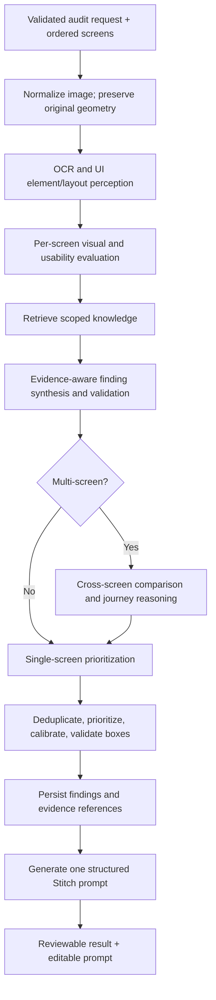

# AI Engine Architecture

**Status:** Draft for review — Phase 01  
**Last reviewed:** 2026-11-16

## 1. Design goals

Produce useful, localized, calibrated design findings without claiming more than supplied screenshots and retrieved sources establish. Use modular stages with versioned typed contracts. Model output is a proposal, not trusted ground truth.

## 2. Processing pipeline



### Stage responsibilities

1. **Image preparation:** verify dimensions, orientation, color profile, and file type; produce model-sized derivatives with transformations recorded. Never lose mapping to original coordinates.
2. **Screenshot understanding:** describe screen purpose and visible hierarchy as hypotheses, grounded in image regions.
3. **UI element detection:** combine OCR/layout or visual grounding to identify candidate text, controls, regions, and boxes. Use the screenshot as the only evidence for visible UI. A detector label is not proof of interactivity.
4. **Visual consistency evaluation:** compare typography, spacing, colors, button styles, alignment, and component patterns; distinguish deliberate variation from inconsistency where context is absent.
5. **Usability evaluation:** assess visible affordances, hierarchy, content clarity, and interaction cues. Phrase behavioral implications conditionally.
6. **Accessibility evaluation:** identify visible risks (e.g., apparent contrast, text size, touch target size, or color-only cues) with measurement caveats. Never claim keyboard or assistive-technology compatibility from a screenshot.
7. **UX flow evaluation:** only for ordered multi-screen input, compare screen affordances, labels, state/content, and requested user intent. Report apparent missing/unclear transitions, not verified product behavior.
8. **Design-system extraction:** infer recurring visual tokens and components across supplied screens; attach confidence and sample references.
9. **Knowledge retrieval:** retrieve only global plus authorized project material; provide excerpts and provenance as untrusted evidence, not instructions.
10. **Prioritization:** combine user impact, scope, frequency, severity, confidence, and fix leverage. Keep confidence distinct from severity.
11. **Prompt generation:** convert selected validated findings and design context into exactly one coherent prompt; include screen order for multi-screen work and preserve unrelated design.

## 3. Finding contract

The persisted/API finding contract must include:

```json
{
  "id": "uuid",
  "title": "string",
  "category": "visual_hierarchy|consistency|usability|accessibility|content|navigation|flow|other",
  "scope": "screen|cross_screen",
  "screen_ids": ["uuid"],
  "bounding_boxes": [
    { "screen_id": "uuid", "x": 0.1, "y": 0.2, "width": 0.3, "height": 0.1 }
  ],
  "description": "string",
  "severity": "low|moderate|high|critical",
  "confidence": 0.0,
  "certainty": "observed|suspected",
  "why_it_matters": "string",
  "recommendation": "string",
  "evidence_class": "visual_observation|source_supported|professional_guidance",
  "knowledge_references": [
    { "document_id": "uuid", "document_name": "string", "page": 3, "chunk_id": "uuid" }
  ]
}
```

Bounding boxes are normalized to the original image, top-left origin, with values constrained to `[0,1]` and positive width/height. A screen-level issue can have no box; do not fabricate one. A cross-screen issue should associate relevant screens and include boxes only where a specific region is implicated. IDs are assigned by the application, not generated as arbitrary model identifiers.

## 4. Evidence policy

- **Visual observation:** directly visible, verifiable content or layout (e.g., label is clipped). State the observed fact and screen/region.
- **Source-supported:** a recommendation materially informed by a retrieved passage. Cite the exact stored document/version and page when available; do not cite model memory.
- **Professional guidance:** general UX/UI practice not directly supported by a retrieved passage.
- **Observed vs suspected:** `observed` means the issue itself is visible; `suspected` means an interpretation, impact, or potential behavior needs confirmation. Use conditional phrasing and lower confidence for unverified assumptions.
- Never infer real interaction, validation, navigation, responsive behavior, accessibility-tree semantics, keyboard support, or screen-reader output solely from a static image.
- Citations are accepted only from retrieved chunk IDs with matching document/page metadata; reject invented or out-of-scope references.

## 5. Multi-screen reasoning (required, not concatenation)

The worker supplies the ordered screen set and per-screen structured observations to a dedicated synthesis stage. That stage must:

1. Compare repeated elements and visual tokens across screens.
2. Map visible controls, labels, progress, state, and content transitions to neighboring screens.
3. Compare the user-described goal and sequence to evidence visible in each screen.
4. Produce cross-screen findings with a relationship explanation and references to at least two screens, unless clearly identified as a suspected missing step.
5. Identify missing transitions as hypotheses, never as observed facts.
6. Preserve both per-screen findings and true relationship-level findings; deduplicate only when evidence and recommended action are materially the same.

Do not send a flattened collage as the only input. Use original screen images with stable IDs and order metadata; model/context limits may require staged or pairwise comparison followed by synthesis.

## 6. Localization and uncertainty controls

- Use OCR/layout anchors and/or a visual grounding detector to propose candidate regions; use vision reasoning to connect findings to those regions.
- Validate finite coordinates, positivity, image bounds, minimum/maximum area, screen identity, and mapping from resized/cropped images.
- Use region-specific boxes only when evidence is localized. Broad concerns can use a bounding region or screen-level scope.
- Establish confidence calibration on expert-labeled examples. Publish only above an empirically selected threshold; otherwise mark as uncertain/suspected or suppress.
- Avoid reporting a numeric confidence as a calibrated probability until calibration testing supports that interpretation.
- If perception/model stages fail, expose stage errors and allow retry; do not silently return zero findings.

## 7. Stitch prompt contract

Generate one prompt, editable and copyable, containing: product/context; screen(s) and intended sequence; current visible layout; selected issues with locations, priority, and rationale; concrete design and accessibility-informed requirements; cross-screen system consistency; constraints to preserve unrelated content/structure; and expected output. Do not promise that Google Stitch will preserve exact source pixels or honor every instruction. Prompt text is user-editable and is not sent to Stitch by this service.

## 8. Evaluation and model lifecycle

Maintain de-identified, permissioned, versioned test sets with expert annotations and disagreement records. Evaluate image/model/provider changes offline before rollout and run a canary against representative production cases. Record model/provider/version, prompt/template version, preprocessing, retrieval configuration, usage, latency, and validation status per audit. See `ACCEPTANCE_CRITERIA.md`.
