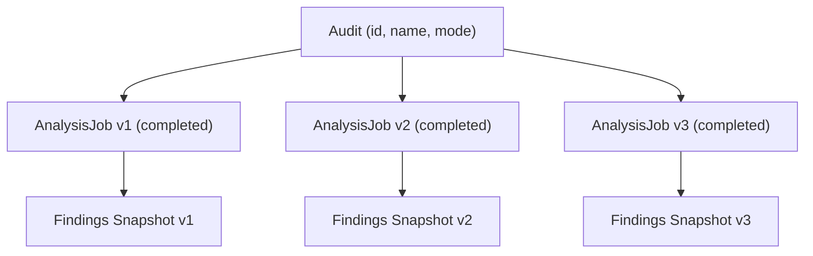

# Analysis Versioning & Comparison Architecture

## 1. Versioning Model
In Forteux, audits represent named evaluations of single screens or multi-screen user flows. When a user runs or reruns an analysis, an immutable `AnalysisJob` is created.

Rather than mutating prior results in place, each `AnalysisJob` constitutes an immutable **version run** of that audit.

### Version Monotonicity
Versions are enumerated chronologically by `AnalysisJob.created_at`. Version 1 represents the initial baseline run, Version 2 represents the first re-analysis, and so on.

---

## 2. Mathematical Comparison Methodology
The comparison endpoint (`GET /projects/{pid}/audits/{aid}/versions/compare?earlier_job_id=X&later_job_id=Y`) performs deterministic comparison between two runs:

1. **Extraction**:
   - Fetch finding records $F_{\text{earlier}}$ for job $X$.
   - Fetch finding records $F_{\text{later}}$ for job $Y$.
2. **Keying**:
   Each finding is indexed by normalized identity:
   $$K(f) = \text{lowercase}(\text{category}) + \text{":"} + \text{lowercase}(\text{title})$$
3. **Partitioning**:
   - **Persistent Findings**: $\forall f \in F_{\text{later}}$ where $K(f) \in F_{\text{earlier}}$ and $f.\text{severity} = f_{\text{earlier}}.\text{severity}$.
   - **Changed Severity Findings**: $\forall f \in F_{\text{later}}$ where $K(f) \in F_{\text{earlier}}$ and $f.\text{severity} \ne f_{\text{earlier}}.\text{severity}$.
   - **New Findings**: $\forall f \in F_{\text{later}}$ where $K(f) \notin F_{\text{earlier}}$.
   - **Resolved Findings**: $\forall f \in F_{\text{earlier}}$ where $K(f) \notin F_{\text{later}}$.

---

## 3. Transparency & Disclaimers
Because computer vision evaluations are probabilistic:
- A resolved finding is explicitly documented as "not detected in this run", which may indicate either a design improvement or a variance in model detection thresholds.
- Comparison limitations are provided with every response to ensure users make informed decisions.
