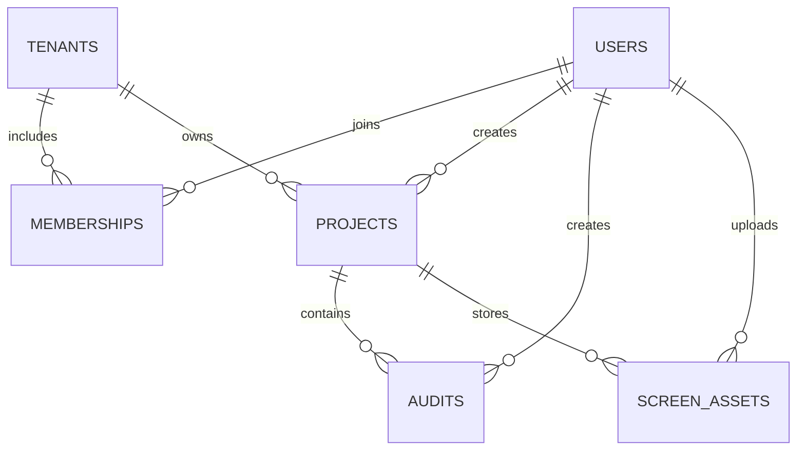

# Database Implementation

**Decision:** PostgreSQL, SQLAlchemy 2 typed ORM models, psycopg 3, and Alembic migrations.

## Implemented entities



| Table | Responsibility and constraints |
|---|---|
| `users` | Local identity mapped by unique `(oidc_issuer, oidc_subject)`; email/display name are profile metadata |
| `tenants` | Workspace ownership boundary; initial verified login creates a personal tenant |
| `memberships` | Composite primary key `(tenant_id, user_id)` and role; every project lookup requires membership |
| `projects` | Tenant-owned project; `(id, tenant_id)` is unique for composite ownership references |
| `audits` | Tenant/project-owned record with `single`/`multi` mode constraint |
| `screen_assets` | Tenant/project-owned object metadata, declared type/size, lifecycle status and per-uploader idempotency |

All records use UUID primary keys and timezone-aware timestamps. Composite foreign keys on audits and screen assets enforce that referenced projects belong to the same tenant. Indexes support tenant/project chronology and unique constraints prevent duplicate storage keys and idempotency keys.

Findings, ordered audit screens, processing jobs, knowledge documents/chunks, embeddings, and Stitch prompts are not present in the foundation migration. They remain future domain entities and are not represented by placeholder tables.

## Migration

The initial revision is `0001_foundation`; `upgrade` creates the six tables and indexes, and `downgrade` removes them in reverse dependency order.

From the `backend` directory:

```powershell
.\.venv\Scripts\alembic.exe upgrade head
.\.venv\Scripts\alembic.exe current
```

Set `DATABASE_URL` to a PostgreSQL URL for deployment. Migrations should be run once by the release pipeline using a role with schema permissions; the application role should have only the permissions needed at runtime.

## Ownership and transactions

`get_current_principal` creates or retrieves identity and membership from verified OIDC claims. Project, audit, and asset routes constrain lookups by tenant, project, membership, and soft-delete state. Upload initiation creates a pending row and presigned URL in one transaction; the unique idempotency constraint handles concurrent duplicate requests. Asset deletion first marks the record `deleting`; it becomes `deleted` only after object cleanup succeeds.

## Validation

The test suite applies the migration to a temporary SQLite database, verifies expected tables, and downgrades it. Route tests exercise tenant isolation and owner attribution. SQLite is test-only and does not establish production PostgreSQL compatibility or availability; validate migrations and TLS/connection options against a disposable PostgreSQL instance in CI/staging before production.
