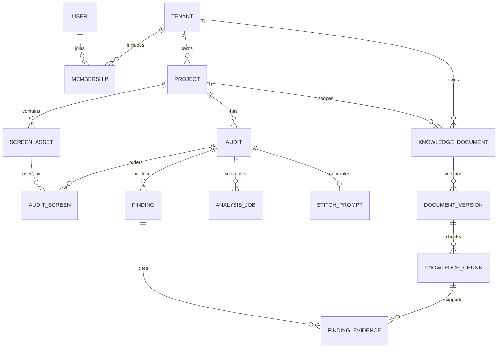

# Database Schema

**Status:** Product target schema; initial ownership/storage subset implemented  
**Last reviewed:** 2026-11-16

## 1. Conventions

- PostgreSQL is the source of truth; use UUID primary keys, UTC timestamps, foreign keys, and soft deletion where auditability requires it.
- Every customer-owned row is scoped by `tenant_id`; project-level entities also carry `project_id` where appropriate. Enforce access in application authorization and database policies, not by trusting client-supplied IDs.
- `NULL project_id` is reserved for explicitly global, administrator-managed knowledge. It is not a wildcard for user-created documents.
- Store images and source documents in private object storage. Database rows contain opaque object keys, checksums, media metadata, and lifecycle state, not public URLs.
- Define enums or constrained strings centrally and version schemas for AI outputs.

## 2. Entity relationships

## 3. Core tables

### Identity and projects

- **users**: `id`, external identity subject (unique per issuer), email/display metadata as needed, `created_at`, `disabled_at`.
- **tenants**: `id`, `name`, `plan`, `status`, `created_at`, `deleted_at`.
- **memberships**: `tenant_id`, `user_id`, `role` (`owner`, `admin`, `member`), `created_at`; unique `(tenant_id,user_id)`.
- **projects**: `id`, `tenant_id`, `name`, optional `description`, `settings_json`, `created_by`, timestamps, `deleted_at`; index by `(tenant_id, updated_at)`.

### Screens, audits, findings, and prompts

- **screen_assets**: `id`, `tenant_id`, `project_id`, `created_by`, `object_key`, `sha256`, `mime_type`, `byte_size`, `width_px`, `height_px`, optional `display_name`, `status`, `created_at`, `deleted_at`. Do not store signed URLs.
- **audits**: `id`, `tenant_id`, `project_id`, `created_by`, `mode` (`single`, `multi`), `status`, `context_json`, `requested_knowledge_categories`, `model_config_version`, `created_at`, `completed_at`, `error_code`, `error_summary`. Avoid provider secrets and raw prompts in routine logs.
- **audit_screens**: `id`, `tenant_id`, `audit_id`, `screen_asset_id`, `sequence_index`, optional `screen_label`, `user_context`; unique `(audit_id,sequence_index)`.
- **analysis_jobs**: `id`, `tenant_id`, `audit_id`, `kind`, `stage`, `status`, `attempt`, `idempotency_key`, `queued_at`, `started_at`, `finished_at`, `error_code`, `retryable`, `usage_json`; unique `(tenant_id,idempotency_key)`.
- **findings**: `id`, `tenant_id`, `audit_id`, optional `screen_asset_id` for a single-screen finding, `scope` (`screen`, `cross_screen`), `category`, `title`, `description`, `why_it_matters`, `recommendation`, `severity`, `confidence`, `certainty` (`observed`, `suspected`), `evidence_class` (`visual_observation`, `source_supported`, `professional_guidance`), `bbox_json` nullable, `schema_version`, `created_at`, `dismissed_at`. Validate coordinate range and screen association. Cross-screen findings may have no single box.
- **finding_screens**: `tenant_id`, `finding_id`, `screen_asset_id`, optional `bbox_json`, `relationship_note`; used when a finding spans screens.
- **finding_evidence**: `tenant_id`, `finding_id`, `knowledge_chunk_id`, `quote_or_paraphrase`, `page_number` snapshot, `source_title` snapshot, `retrieval_rank`, `created_at`. A citation must reference an actual retrieved chunk.
- **stitch_prompts**: `id`, `tenant_id`, `audit_id`, `version`, `content`, `selected_finding_ids`, `edited_by_user`, `created_at`; unique `(audit_id,version)`. Keep generated and user-edited versions distinguishable.

### Knowledge library

- **knowledge_categories**: `id`, scope (`global`, `tenant`), optional `tenant_id`, `name`, optional `description`, `created_by`, timestamps.
- **knowledge_documents**: `id`, scope (`global`, `project`), nullable `tenant_id` only for global platform-managed documents, nullable `project_id` for global scope, `category_id`, `display_name`, `active_version_id`, `status`, `uploaded_by`, `created_at`, `deleted_at`. Constraint: project scope requires both tenant and project; global scope is administrator-owned and cannot be user-visible across tenants by accidental query.
- **document_versions**: `id`, `document_id`, `version_number`, `object_key`, `sha256`, `mime_type`, `byte_size`, `page_count`, `extractor_version`, `status`, `created_at`, `processed_at`, `error_code`; unique `(document_id,version_number)`.
- **knowledge_chunks**: `id`, `tenant_id` nullable only for platform-global records, `project_id` nullable only for global scope, `document_version_id`, `chunk_index`, `text`, `page_start`, `page_end`, `source_offset_start`, `source_offset_end`, `metadata_json`, `embedding` (pgvector; dimensionality fixed per embedding model), `embedding_model`, `created_at`; indexes on scope filters, document version, and vector. Scope constraints and queries must match document ownership.

### Operations and feedback

- **audit_feedback**: `id`, `tenant_id`, `audit_id`, optional `finding_id`, `user_id`, `feedback_type`, optional bounded text, `created_at`; feedback is not automatically ground truth.
- **deletion_tasks**: `id`, scope and resource ID, `status`, `requested_at`, `completed_at`, `error_code`; tracks object and vector cleanup until verified.

## 4. Indexes and integrity

- B-tree indexes on `(tenant_id, project_id, created_at)` for project assets/audits and foreign-key columns.
- Unique idempotency keys and ordered screen indexes; cascade only within clearly owned records.
- pgvector HNSW/IVFFlat choice based on measured dataset size and recall/latency; include pre-filtered scope conditions or partitioning so approximate search cannot bypass authorization.
- Use transactions for audit creation, sequence updates, active version switch, and prompt/finding persistence.
- Prefer deletion tombstones and asynchronous storage/vector cleanup; only report complete deletion after all tracked stores are processed or explicitly communicate remaining retention.
- Database row-level security is a defense-in-depth option after connection-pooling behavior is validated; never rely on it as the sole authorization mechanism.

## 5. Retention and migrations

Retention duration is an approval decision. On tenant/project deletion, prevent new access immediately, enqueue deletion of originals, derived files, chunks, embeddings, prompts, and related data according to policy, and retain only legally required minimal tombstones. Keep migration scripts reversible where practical; version AI payloads independently of relational schema.

## 6. Foundation implementation boundary

The initial Alembic revision currently creates `users`, `tenants`, `memberships`, `projects`, `audits`, and `screen_assets`. The implemented ORM includes UUIDs, timestamps, tenant/project composite foreign-key constraints, indexes, mode/status/size checks, unique object keys, and upload idempotency. The remaining entities in this Phase 01 target schema (including audit screens, findings, jobs, knowledge documents/chunks, evidence, prompts, and deletion tasks) are not implemented yet. See [DATABASE_IMPLEMENTATION.md](./DATABASE_IMPLEMENTATION.md) for the exact migration and test status.
