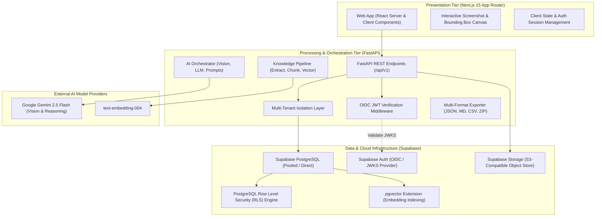
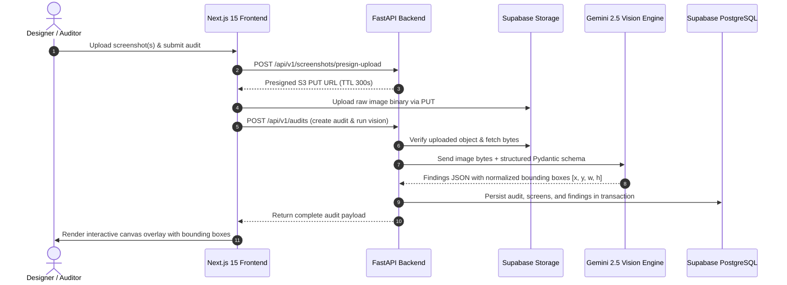
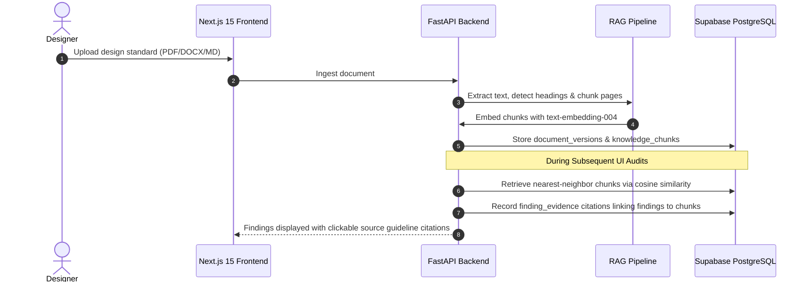
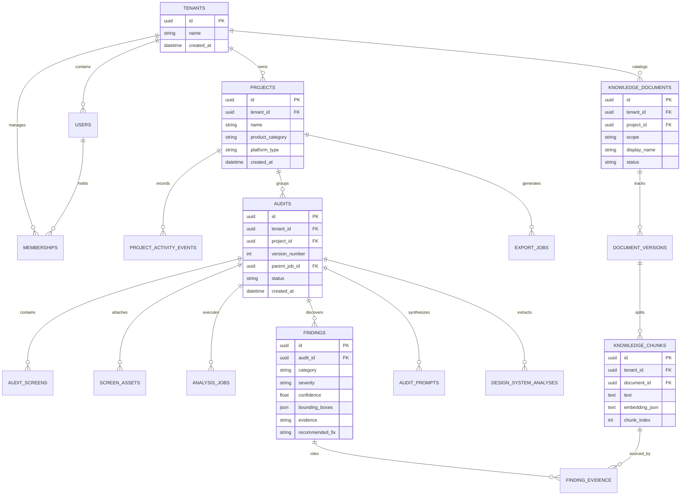

# Forteux: Final System Architecture Document

**Version**: 1.0.0 (Production Release)  
**Date**: November 17, 2026  
**Target Environment**: Next.js 15 Frontend, FastAPI Backend, Supabase Infrastructure (PostgreSQL, Auth, Storage, RLS, pgvector)

---

## 1. System Overview & Component Responsibilities

Forteux is an enterprise AI-powered UI/UX design auditing, consistency evaluation, and redesign platform. The system architecture divides responsibilities across three primary tiers:

---

## 2. Key Data Flow Sequences

### 2.1 Single & Multi-Screen AI Vision Audit Flow

### 2.2 Knowledge Library RAG & Contextual Finding Flow

---

## 3. Relational Entity-Relationship Diagram

---

## 4. Security Architecture & Threat Model

1. **Authentication Boundary**:
   - Asymmetric RSA256 signature verification via Supabase GoTrue JWKS endpoint.
   - Development token bypass strictly forbidden in production (`APP_ENV=production` guard).
2. **Tenancy & Data Isolation**:
   - All relational tables enforce tenant isolation at both the application layer (`tenant_id == principal.tenant_id`) and the database engine level via PostgreSQL Row Level Security (RLS) policies.
3. **Storage Security**:
   - Private Supabase Storage buckets.
   - Presigned time-limited URLs for asset upload and download.
   - Magic byte validation prevents executable uploads.
4. **Transport Encryption**:
   - Production PostgreSQL connections require TLS (`sslmode=require`).
   - All API endpoints communicate over HTTPS.

---

## 5. Deployment Topology

- **Frontend Tier**: Next.js 15 hosted on Google Cloud Run or Vercel edge runtime.
- **Backend Tier**: FastAPI container instances orchestrated with autoscaling ($1 \to 20$ pods).
- **Data Tier**: Managed Supabase PostgreSQL, Supabase Auth, and Supabase Storage in the designated cloud region.
