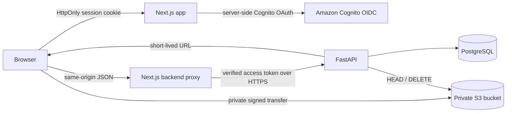

# Foundation Implementation Report

**Status:** Implemented and locally tested; external-service deployment remains unverified.

## Summary

The project now has a FastAPI backend foundation, PostgreSQL-oriented SQLAlchemy schema and Alembic migration, Cognito-compatible OIDC authentication, private S3 storage integration, and a same-origin Next.js API client/proxy. Existing frontend routes and demo behavior remain in place.

No AI analysis, screenshot decoding/normalization, OCR, knowledge-document processing, or analysis worker was added. Screenshot uploads are stored as `uploaded_unverified` after checking S3 object metadata; this does not establish that the object bytes are a valid image.

## Final technology decisions

| Area | Decision | Implications |
|---|---|---|
| Web | Existing Next.js, React, TypeScript app | Server-side API proxy keeps bearer tokens and backend URL out of browser code |
| Web authentication | NextAuth v4 JWT session with Amazon Cognito OIDC | Cognito app-client secret and `NEXTAUTH_SECRET` are server-only; session renewal/re-authentication policy must be revisited before production |
| API authentication | FastAPI verifies Cognito RS256 access tokens using the issuer JWKS | API does not trust browser-supplied user IDs or accept identity from session headers |
| API/schema | FastAPI and Pydantic v2 | Modular routes/schemas and stable JSON errors |
| ORM/migrations | SQLAlchemy 2 and Alembic | Schema changes are versioned; production migration must run as a deployment step |
| Database | PostgreSQL via psycopg 3 | SQLite is used only for isolated tests; production startup/readiness rejects non-PostgreSQL URLs |
| User/project ownership | Users belong to tenant workspaces through memberships; first verified sign-in creates a personal tenant | Project access is determined from backend membership, not frontend tenant selection |
| Object storage | Private AWS S3 bucket with short-lived presigned PUT/GET URLs | Bucket and IAM configuration are deployment prerequisites; optional S3-compatible endpoint supports development/alternate implementations |

## Architecture

The object store never receives its credentials in the browser. The API creates server-generated object keys after project authorization. The current bucket template blocks all public access, enables default server-side encryption, restricts transport to TLS, and limits CORS to the configured web origin.

## Database design

The initial migration creates `users`, `tenants`, `memberships`, `projects`, `audits`, and `screen_assets`. UUID keys, timestamps, indexes, checks, ownership foreign keys, composite project/tenant constraints, and upload idempotency constraints are included. Findings, analysis jobs, knowledge documents, embeddings, and audit-screen ordering remain future schema work; they were not created as duplicate or unused entities.

## Implemented API and storage path

The protected API currently supports identity lookup, project list/create/read, audit create/list/read, upload intent creation, upload completion, asset listing/download URL, and asset deletion.

1. The caller must have a verified OIDC access token and project membership.
2. The API validates declared PNG/JPEG content type, extension, size limit, and an idempotency key.
3. It generates an opaque S3 key and a short-lived signed PUT URL.
4. On completion, it checks that the S3 object exists and that stored content type and byte count match the declarations.
5. Retrieval uses a short-lived attachment URL; deletion first revokes application access, then removes the object.

Image signatures, actual decoding, dimensions, malware scanning, and normalization are intentionally deferred to the approved screenshot-processing phase.

## Security boundaries

- The frontend proxy reads the access token from the server-side NextAuth session and adds the Authorization header. The browser does not receive the API access token or Cognito client secret.
- FastAPI validates token signature, issuer, expiration, `token_use=access`, and Cognito `client_id`; user identity is mapped from issuer and subject.
- Every project/audit/asset query is constrained by membership and tenant. Database composite foreign keys prevent project/tenant mismatches.
- S3 object keys and signed URLs are created on the server. URLs are short-lived and scoped to one object and operation.
- Uploaded files and names remain untrusted. Metadata verification is not a content validation or malware scan.
- Production settings require PostgreSQL and HTTPS OIDC/S3 endpoints. No secrets are committed; use a secret manager for deployed environments.

## Verification and limitations

See [FOUNDATION_TEST_REPORT.md](./FOUNDATION_TEST_REPORT.md) for executable test evidence. Automated tests use SQLite, generated test keys, and an offline S3 client; they do not prove that a live Cognito pool, PostgreSQL instance, AWS IAM role, bucket, or CloudFormation stack is deployed or operational. Those external services are not configured in this workspace.

Before production use, provision and validate Cognito, PostgreSQL TLS, S3 bucket/IAM permissions, secret management, CORS, backups, retention, alerting, and production HTTPS. The CloudFormation templates are implementation templates and have not been deployed here.

## Phase boundary

This completes the backend foundation only. It does not implement image processing or any AI/knowledge features. Continue to Phase 03 screenshot processing only after reviewing and approving the foundation handoff and provisioning the required services.
