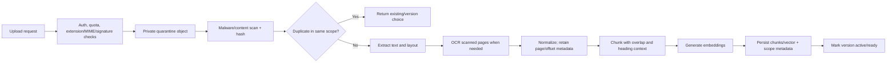

# Knowledge Library Architecture

**Status:** Draft for review — Phase 01  
**Last reviewed:** 2026-11-16

## 1. Scope and principles

The library enriches reasoning; it is not a closed-world source of truth and does not override system or product instructions. Global content is platform-managed and explicitly reviewed. Project content is private to the owning tenant/project. Every extracted passage retains provenance.

## 2. Supported inputs

**Initial:** PDF (text and scanned), DOCX, TXT, Markdown.  
**Candidate after validation:** HTML and PPTX.  
Reject or quarantine executable/active content, archives, unsupported types, malformed or encrypted documents that cannot be safely processed. Define upload-byte and document-page limits before launch. File extensions and MIME headers are hints only.

## 3. Ingestion pipeline

### Processing details

- Persist an upload record and job before acknowledging acceptance.
- Use signature-based format detection, malware scanning, decompression-bomb defenses where relevant, encrypted-document policy, and bounded CPU/memory/time.
- Prefer deterministic native extraction first (e.g., PDF text extraction and DOCX parsing); OCR only where text coverage/quality warrants it. Preserve page, section, and offsets. Record extractor/OCR version and extraction warnings.
- Normalize whitespace and remove repeated headers/footers only when safely identified; retain source text and offsets needed for citations.
- Chunk by semantic boundaries with bounded token size and modest overlap. Store page span and source offsets per chunk. Keep chunking/embedding versions.
- Generate embeddings behind a provider interface. Store model name, dimensions, and content hash; re-embed when model version changes.
- Keep a new replacement version pending until all extraction/index steps succeed; then atomically activate it. A failed replacement must not remove the last ready version.
- Deletion removes the document from retrieval immediately, then deletes vectors and objects asynchronously with verifiable completion state.

## 4. Retrieval pipeline

1. Authorize the audit’s tenant/project and determine exact allowed scopes (platform-global plus that project only).
2. Build retrieval queries from the user’s product context and validated issue/topic descriptors; do not transmit raw images to the vector service.
3. Apply metadata filters before semantic retrieval. Combine vector similarity and lexical/BM25 retrieval to handle exact terms; merge/rerank with a configurable model or deterministic rank fusion.
4. Apply relevance threshold and result diversity limits. Retrieve bounded, deduplicated excerpts with document title, page, version, and chunk IDs.
5. Pass excerpts to the reasoning stage as quoted, untrusted reference material. Ask the model to explicitly link a recommendation to a reference only when supported.
6. Validate all returned references against retrieved chunk IDs and stored metadata; strip or reject fabricated citations.
7. Persist the retrieval trace needed for quality evaluation, subject to privacy retention policy.

Global and project knowledge are ranked together only after access filtering. Tenant data must never be embedded as a global shared document. Retrieval is advisory; the model may disagree with a source or rely on general professional knowledge, but the result must label which is which.

## 5. Duplicate, replacement, category, and status behavior

- Compare SHA-256 within an authorized scope; identical files in different projects are not automatically linked or exposed.
- Offer explicit “already uploaded” and replace/new-version choices. Do not silently overwrite.
- Categories have controlled names and optional user-defined project categories; category is metadata/filtering, not a trust level.
- Status lifecycle: `uploaded -> queued -> processing -> ready | failed`; deletion uses `deleting -> deleted` with retryable cleanup errors.
- Expose extraction warnings (e.g., OCR low confidence or missing page text) and allow reprocess with a newer extractor.
- Enforce replacement authorization and prevent concurrent updates from activating stale versions.

## 6. Prompt-injection and content safety

Documents can contain instructions intended to manipulate an AI. Treat extracted text strictly as data; delimit it, label provenance, and tell the model to ignore instructions inside references. Do not concatenate uploaded instructions into system/developer messages or allow them to select tools, change policy, or request secrets. Apply content scanning and adversarial tests, but do not assume scanning eliminates prompt injection. Restrict model tools to the minimum required; analysis and retrieval should not grant arbitrary network, file, or account actions.

## 7. Operational metrics and cost

Track accepted/failed extraction rates, OCR pages, time per stage, chunk counts, embedding tokens, vector query latency, citation precision, per-document cost, and deletion lag. Set quotas and cost alerts. OCR, embedding, reranking, and duplicate reprocessing are direct cost drivers; cache only with versioned content hashes and correct scope isolation.
