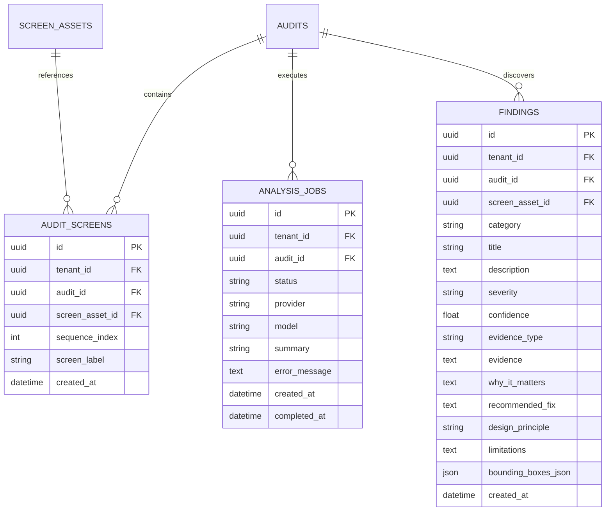

# Phase 04: Structured Findings Schema

## 1. Overview

This document specifies the exact JSON schema and database representation for UI/UX audit findings, bounding boxes, and analysis jobs implemented in Phase 04.

---

## 2. JSON Schema: Finding Object

```json
{
  "$schema": "https://json-schema.org/draft/2020-12/schema",
  "title": "FindingRead",
  "type": "object",
  "required": [
    "id",
    "category",
    "title",
    "description",
    "severity",
    "confidence",
    "evidence_type",
    "why_it_matters",
    "recommended_fix"
  ],
  "properties": {
    "id": {
      "type": "string",
      "format": "uuid",
      "description": "Unique identifier of the finding."
    },
    "audit_id": {
      "type": "string",
      "format": "uuid",
      "description": "Foreign key to the audit."
    },
    "category": {
      "type": "string",
      "enum": [
        "visual_hierarchy",
        "layout_spacing",
        "typography",
        "color_contrast",
        "components_consistency",
        "usability",
        "accessibility_indicator"
      ]
    },
    "title": {
      "type": "string",
      "minLength": 3,
      "maxLength": 255
    },
    "description": {
      "type": "string",
      "minLength": 5
    },
    "severity": {
      "type": "string",
      "enum": ["critical", "high", "medium", "low"]
    },
    "confidence": {
      "type": "number",
      "minimum": 0.0,
      "maximum": 1.0
    },
    "evidence_type": {
      "type": "string",
      "enum": ["observed", "inferred"]
    },
    "evidence": {
      "type": ["string", "null"]
    },
    "why_it_matters": {
      "type": ["string", "null"]
    },
    "recommended_fix": {
      "type": ["string", "null"]
    },
    "design_principle": {
      "type": ["string", "null"]
    },
    "limitations": {
      "type": ["string", "null"]
    },
    "bounding_boxes": {
      "type": "array",
      "items": {
        "type": "object",
        "required": ["x", "y", "width", "height"],
        "properties": {
          "x": { "type": "number", "minimum": 0.0, "maximum": 1.0 },
          "y": { "type": "number", "minimum": 0.0, "maximum": 1.0 },
          "width": { "type": "number", "exclusiveMinimum": 0.0, "maximum": 1.0 },
          "height": { "type": "number", "exclusiveMinimum": 0.0, "maximum": 1.0 }
        }
      }
    }
  }
}
```

---

## 3. Database Schema Mapping


