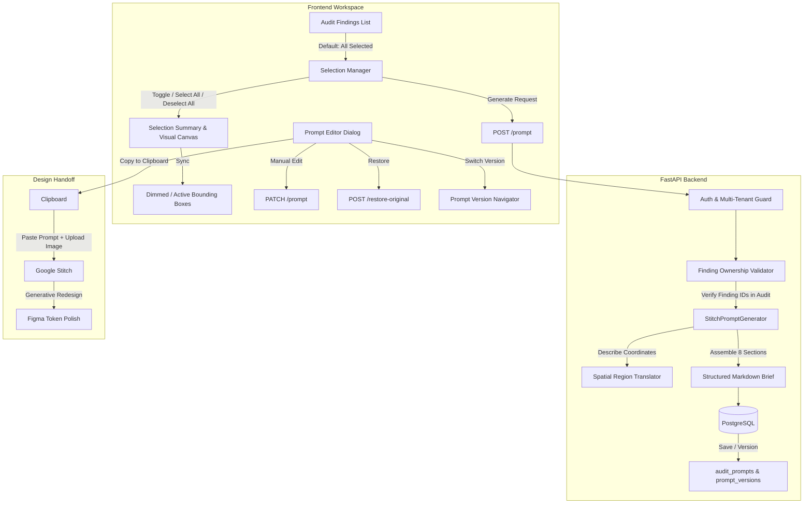

# Phase 05 Architecture: Finding Review & Google Stitch Prompt Generation

## 1. System Overview

Phase 05 establishes the bridge between diagnostic UI/UX evaluation and generative redesign in Google Stitch. The architecture ensures that every generated prompt is strictly grounded in verified audit findings, spatial layout context, and user design intent.

---

## 2. Component Architecture

### 2.1 Spatial Region Translation (`describe_region`)
Generative models perform significantly better when supplied with semantic spatial descriptions alongside quantitative pixel coordinates. The `describe_region` utility translates normalized coordinates $(x, y, w, h) \in [0, 1]$ into a two-axis sector:
- **Vertical Sector**:
  - $y < 0.20 \implies \text{Top}$
  - $0.20 \le y < 0.65 \implies \text{Mid}$
  - $y \ge 0.65 \implies \text{Bottom}$
- **Horizontal Sector**:
  - $x < 0.30 \implies \text{Left}$
  - $0.30 \le x < 0.65 \implies \text{Center}$
  - $x \ge 0.65 \implies \text{Right}$

Resulting descriptor:
`"Top-Right section (approx. x: 80%, y: 5%, width: 15%, height: 6%)"`

### 2.2 Finding Ownership & Security Validation
Before a prompt is generated or updated, the backend enforces tenant and audit ownership:
1. Validates that the target `Audit` belongs to the authenticated user's active tenant.
2. Queries all findings in the database matching `audit_id` and the supplied `selected_finding_ids`.
3. If the count of matching findings does not equal `len(selected_finding_ids)`, the request is immediately rejected with HTTP 400 (`code: invalid_findings`). This guarantees that foreign or cross-tenant finding IDs cannot be injected into prompts.

### 2.3 Prompt Versioning & Immutability
- **Initial Generation**: Creates an `AuditPrompt` record with `version_number = 1`, and simultaneously creates an initial `PromptVersion` record (`version_number = 1`).
- **Regeneration**: Increments `version_number` by 1 on `AuditPrompt`, updates `content` and `original_content`, and appends a single new `PromptVersion` entry.
- **Manual Editing**: Updates `content` on `AuditPrompt` via `PATCH`. `original_content` remains untouched.
- **Restore Original**: Copies `original_content` back to `content` on `AuditPrompt`, providing a safe undo mechanism.

---

## 3. The 8-Section Redesign Brief Structure

Every generated prompt strictly follows this deterministic 8-section layout:
1. **Title & Header**: `# Google Stitch Redesign Brief: {Product Name}`
2. **Role & Objective**: Direct instruction positioning the AI model as Principal UI/UX Designer & Google Stitch prompt engineer.
3. **Existing Interface Context**: Context extracted from audit metadata (product, user goal, target audience, viewport geometry).
4. **Core Design Objectives**: Categorical objectives aggregated from selected finding categories.
5. **Prioritized Issues & Required Design Solutions**: Individual issues sorted by severity (Critical $\to$ High $\to$ Medium $\to$ Low) with visual evidence, why it matters, required improvement, and design principle.
6. **Visual Design Requirements**: Core layout and system constraints (8pt grid, typographic contrast scale, button hierarchy, perceptual contrast).
7. **User-Specified Design Instructions** *(Conditional)*: Clean injection of user-supplied overrides and preferences.
8. **Strict Design Constraints**: Boundary conditions preventing unrequested scope creep or brand destruction.
9. **Expected Output & Google Stitch Handoff**: Clear guidelines on providing the screenshot and exporting the final design.
