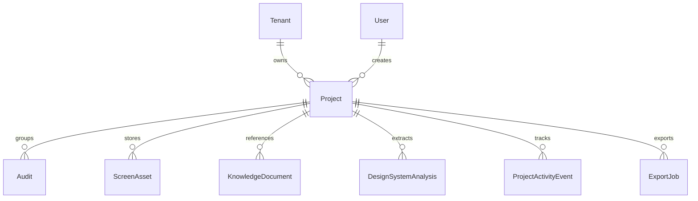

# Project Management Architecture

## 1. Project Entity Model
A `Project` represents the top-level container for all UI/UX auditing workflows, asset uploads, RAG reference documents, and extracted design systems.

### Attributes
- `id`: Unique UUID identifier.
- `tenant_id`: Mandatory tenant partitioning.
- `name`: Human-readable title (up to 200 characters).
- `description`: Optional overview text.
- `category`: Product category classification (e.g. Fintech, SaaS, E-commerce).
- `platform_type`: Target deployment platform (Web application, Mobile application, etc.).
- `thumbnail_url`: Optional visual avatar reference.
- `context_text`: Freeform domain context supplied to LLM vision engines during analysis.
- `created_by`: User ID of project creator.
- `created_at`: UTC timestamp.
- `updated_at`: UTC timestamp.
- `archived_at`: Optional timestamp for soft-archiving.
- `deleted_at`: Soft-deletion timestamp.

---

## 2. Project Lifecycle States
1. **Active**: Standard operating state. Audits can be created, edited, and analyzed.
2. **Archived (`archived_at != null`)**: Read-only state. Historic audits and exports remain accessible, but creation of new resources is discouraged until restored.
3. **Deleted (`deleted_at != null`)**: Inaccessible state. Excluded from all standard queries via `Project.deleted_at.is_(None)` guards.

---

## 3. Activity Event Logging
Every significant mutation to a project produces a `ProjectActivityEvent` record:
- `project_created`
- `project_updated`
- `project_archived`
- `project_restored`
- `project_deleted`
- `audit_created`
- `export_generated`

Events contain safe, concise human-readable descriptions and can be queried via `GET /projects/{project_id}/activity`.
