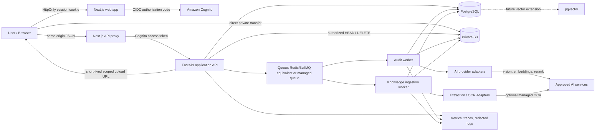

# System Architecture

**Status:** Foundation decisions implemented; full product architecture remains the target  
**Last reviewed:** 2026-11-16

## 1. Recommended architecture

Use a modular, asynchronous application with a Next.js web client, a Python API and worker boundary, PostgreSQL as the system of record, pgvector for initial semantic retrieval, private S3-compatible object storage, and a durable job queue. Keep provider adapters behind application-owned interfaces. Begin as a modular backend, not a fleet of microservices; separate API and worker deployment units only where scaling or workload isolation requires it.

The implemented foundation currently includes the browser, Next.js session/proxy, Cognito-compatible authentication, FastAPI, PostgreSQL schema, and private S3 integration. The remaining queue, workers, pgvector, AI, OCR, and knowledge components in the diagram are future target architecture, not deployed services. Queue technologies should be finalized before background work is introduced; do not make Redis the sole durable record of audit state.

## 2.1 Foundation implementation status

- **Selected and implemented:** Next.js/TypeScript, FastAPI/Pydantic, Cognito OIDC, PostgreSQL, SQLAlchemy 2, Alembic, and private S3-compatible storage.
- **Selected but not deployed:** AWS Cognito and S3 CloudFormation templates; PostgreSQL service, IAM roles, secret manager, and production networking.
- **Future product work:** image validation/processing, analysis and knowledge workers, queue, pgvector, AI provider adapters, and audit/knowledge domain tables.
- **Verification boundary:** local tests cover SQLite, test-signed OIDC tokens, and offline SigV4 URL generation. They are not live cloud-service or production-readiness evidence.

## 3. Component responsibilities

- **Web app:** projects, ordered screen upload/reorder, knowledge management, progress, accessible annotations/finding list, prompt editor, and feedback.
- **API:** authentication/authorization, validation, signed upload/download URLs, project and audit lifecycle, job enqueueing, result access, prompt persistence, rate and quota enforcement.
- **Audit worker:** image normalization, per-screen perception, element/text detection, screen comparisons, flow reasoning, evidence retrieval, finding validation, ranking, prompt inputs, and result persistence.
- **Knowledge worker:** file inspection, extraction/OCR, normalization, deduplication, chunking, embedding, index update, replacement and deletion coordination.
- **PostgreSQL:** canonical records, tenant/project access boundaries, job state, audit outputs, provenance, and vector index for initial scale.
- **Object storage:** encrypted private originals and derived artifacts with narrowly scoped, short-lived access.
- **Provider adapters:** common typed request/response interfaces, model capability registry, timeout/retry policy, usage/cost accounting, and provider-specific mappings.

## 4. Architectural principles

1. Treat client and model output as untrusted; validate every request, file, provider response, and persisted geometry.
2. Persist job state and stage outputs before reporting success. Make queue delivery at-least-once safe through idempotency keys and unique stage records.
3. Store original coordinate dimensions. Use normalized `x`, `y`, `width`, and `height` in `[0,1]`; derive pixel positions at render time and clamp/validate boxes server-side.
4. Distinguish unsupported, uncertain, inferred, and observed data explicitly in API types and UI.
5. Keep customer content out of telemetry by default; use opaque IDs, redaction, retention controls, and opt-in evaluation datasets.
6. Version prompts, schemas, model IDs, preprocessing, retrieval configuration, and evaluation sets for reproducibility.

## 5. Deployment view

Recommended cloud-neutral logical deployment, with AWS as a reasonable first implementation: CDN/WAF and managed identity at the edge; web and API containers; private PostgreSQL; private object storage; a managed queue/cache; isolated worker containers; secrets manager/KMS; and centralized metrics/traces. Pin data residency and AI-provider regions together. Keep network egress from workers restricted to storage, database, queue, telemetry, and approved AI endpoints.

## 6. Scaling and resilience

- Scale API on request load and audit/knowledge workers independently on queue depth and age.
- Apply per-tenant concurrency limits, provider quotas, back-pressure, and bounded retries with jitter.
- Use a dead-letter queue and visible failed state after retry exhaustion; provide safe user retry.
- Apply image resizing/tiling only as model-aware derived inputs; retain originals and mapping metadata.
- Cache embeddings by content hash plus embedding-model/version, never across incompatible scopes as an authorization shortcut.
- Introduce a dedicated vector service only after measured PostgreSQL/pgvector limitations justify its operational cost.
- Degrade transparently when an optional provider or OCR stage is unavailable; do not return a success-shaped empty audit.

## 7. Major risks and mitigations

| Risk | Mitigation |
|---|---|
| Vision model hallucination or imprecise boxes | Separate perception/localization; require screenshot-grounded evidence, geometry validation, confidence thresholds, and human evaluation |
| Multi-screen result is merely a concatenation | Dedicated comparison and journey stages over ordered screens; cross-screen test set; require evidence linked to two or more screens where appropriate |
| Prompt injection in uploaded references | Treat extracted text as quoted data, isolate it from system/developer instructions, screen suspicious content, and test adversarial documents |
| Provider model drift/deprecation | Capability registry, pinned versions where possible, provider contracts, migration tests, and versioned offline evaluations |
| Unbounded AI/document cost | File/page/screen/token limits, early deduplication, quotas, caching, batching where appropriate, budget alerts, and per-stage cost tracking |
| Privacy or scope leakage | Tenant/project predicates and row-level controls, private buckets, authorization tests, deletion workflows, and minimized logs |

## 8. Architecture decisions to approve

The foundation selects AWS, Cognito, a personal-tenant/membership model, and private S3 for the first implementation. Before production, approve the launch region, organization/team product rules, upload and retention limits, durable queue, and primary AI provider. Defaults and implications are recorded in `TECH_STACK_EVALUATION.md` and the foundation implementation reports.
